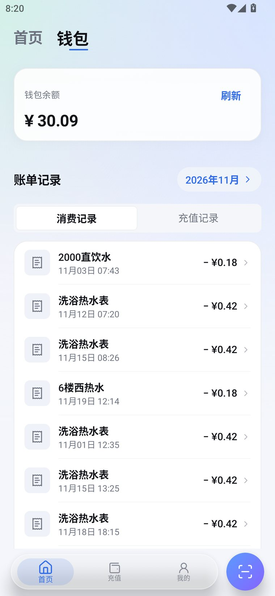
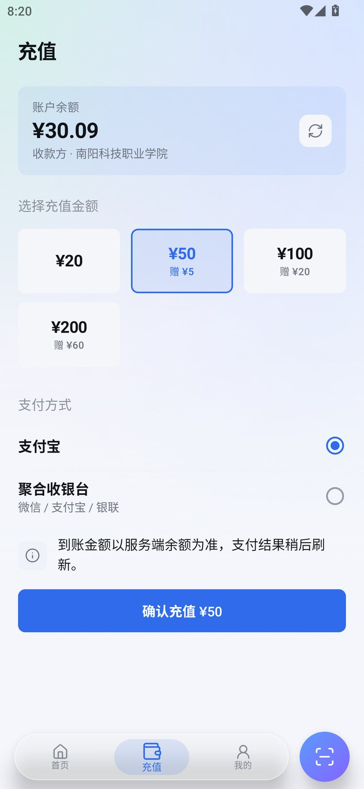
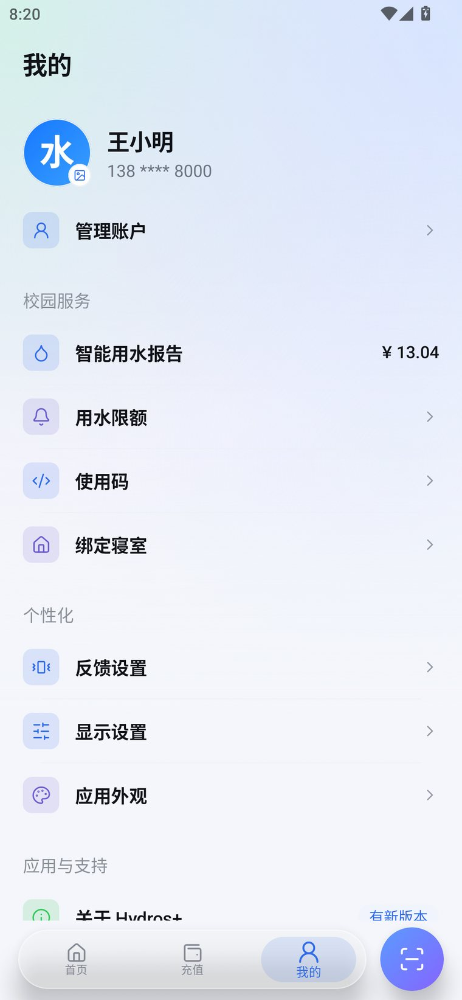
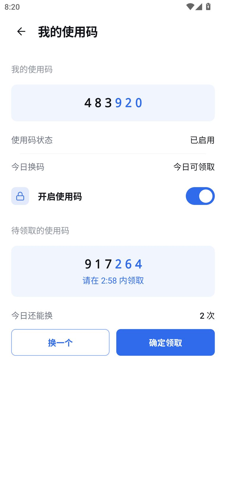
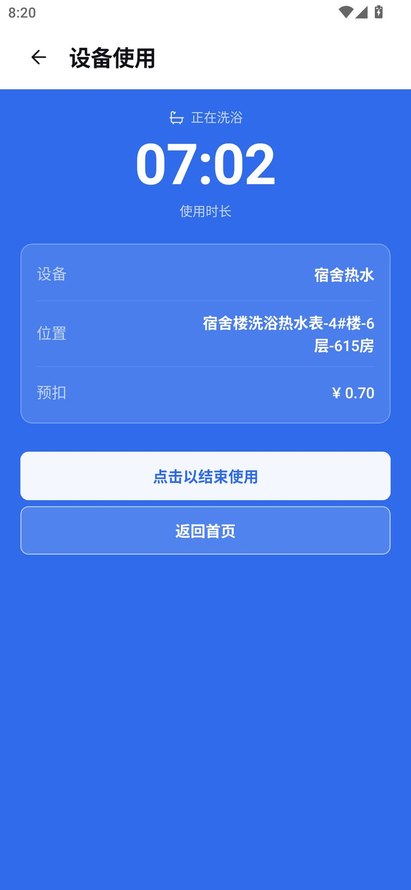
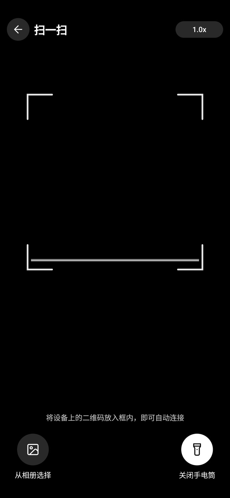
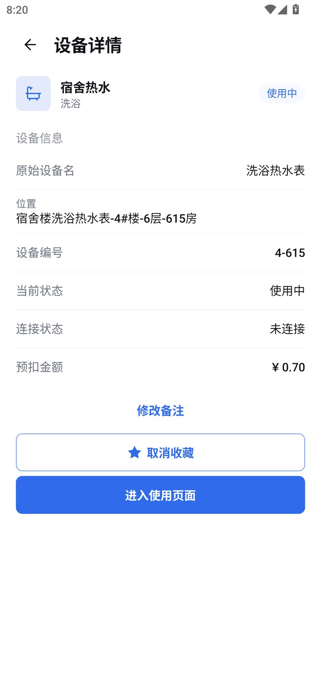
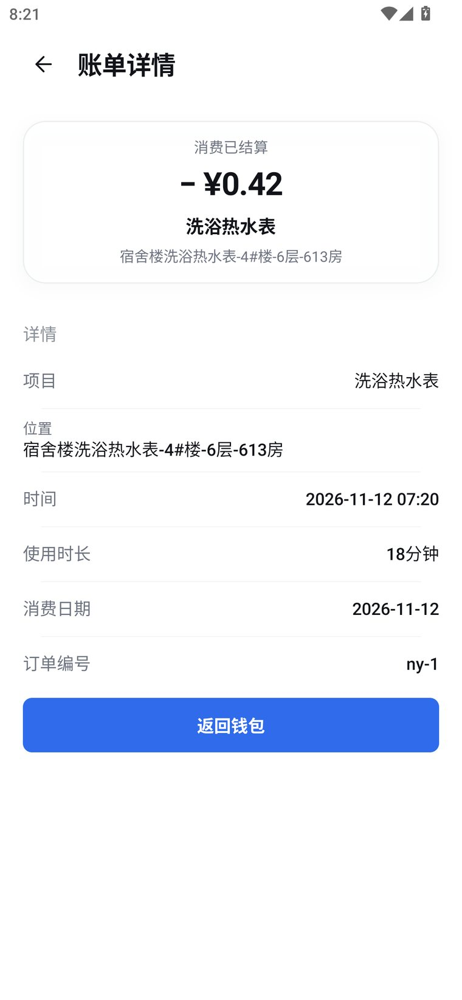
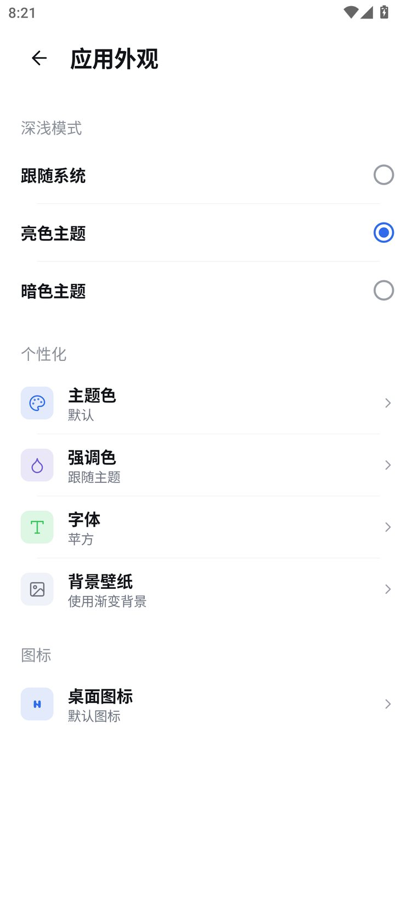

<div align="center">


# Hydros+

**趣智校园第三方客户端 · Kotlin + Jetpack Compose**

用一块更顺眼的界面，把「扫码—用水—账单」这条链路走完。

[](https://kotlinlang.org)
[](https://developer.android.com/jetpack/compose)
[](#)
[](#)
[](LICENSE)

[功能](#-功能) · [截图](#-界面) · [更新日志](CHANGELOG.md) · [构建](#-从源码构建) · [常见问题](#-常见问题)

</div>

> [!WARNING]
> 本项目仅用于「移动开发技术及应用」课程的学习实践与个人自用，**请于下载后 24 小时内删除**。
>
> 所有接口均来自互联网公开信息，未对原应用进行任何破解、逆向；本仓库不提供任何相关教程或服务端实现。使用本软件产生的任何后果由使用者自行承担。

---

## ✨ 功能

### 核心

| | |
|---|---|
| 🔗 **扫码连接** | 扫描设备二维码即可连接，支持相册选图、双指变焦与焦距显示 |
| 🚿 **用水控制** | 长按开始使用，实时计时；结束用水后自动刷新账单 |
| 💳 **钱包与账单** | 余额、消费/充值记录、按月切换、账单详情，数据一目了然 |
| 📶 **附近设备** | 蓝牙扫描周边设备，靠近就能用 |
| ⭐ **收藏与备注** | 常用设备一键开始，支持自定义备注与排序 |

### 拓展

| | |
|---|---|
| 📊 **智能用水报告** | 月度支出、用水次数、日均、单日峰值、高峰时段、主要用途，按天日历热力图，月末预测与节水评分 |
| 🔔 **用水限额** | 设定每月金额上限，达到后在应用内提醒一次，避免月底才发现超支 |
| 🔑 **使用码** | 在设备物理键盘上直接取水，无需每次扫码；支持开关、换码与限时领取 |
| 🏠 **绑定寝室** | 从附近蓝牙设备一键选择并绑定，记录寝室号与设备 MAC |
| 💰 **充值** | 支付宝 / 聚合收银台 / 校园卡三种渠道，显示收款方与赠送金额 |
| 🎨 **外观自定义** | 深浅模式、主题色、强调色、字体（含苹方）、渐变背景、壁纸、桌面图标 |
| 🧑‍💻 **开发者模式** | 演示数据（离线模拟设备/账单/会话）、应用日志、构建信息、重置引导 |
| 🗣️ **语音助手（实验）** | 通过系统助手的「快捷指令」用口令开关水、查余额 |

### 细节

- 首页「连接身边的设备」卡片可在 **显示设置** 中关闭，关闭后不再出现
- 会话页整屏按钮蓝，配色与操作按钮完全一致，无渐变干扰
- 统一的 **8dp 圆角 + 48dp 高度** 按钮规范，长按进度与普通按钮同形
- 固定签名密钥，**升级安装不需要卸载**，登录状态与本地数据完整保留
- 全站 Lucide 图标，深浅色均已适配

---

## 📱 界面

<div align="center">

| 首页 | 钱包 | 充值 | 我的 |
|:---:|:---:|:---:|:---:|
|  |  |  |  |
| **智能用水报告** | **使用码** | **绑定寝室** | **设备使用** |
|  |  |  |  |
| **扫一扫** | **设备详情** | **账单详情** | **应用外观** |
|  |  |  |  |

<sub>截图来自调试用的预览模式，数据均为演示数据。</sub>

</div>

---

## 🧱 技术栈

| 分类 | 选型 |
|---|---|
| 语言 / UI | Kotlin 2.4.10、Jetpack Compose、Material 3 |
| 架构 | 单 Activity + Navigation Compose，手写依赖装配（无 Hilt/Koin） |
| 状态 | `StateFlow` + 单一 `HydrosUiState`，ViewModel 集中收敛 |
| 网络 | Retrofit 3 + OkHttp 5 + kotlinx.serialization |
| 存储 | DataStore Preferences、SharedPreferences、应用私有文件 |
| 硬件 | CameraX + ML Kit（扫码）、蓝牙（附近设备） |
| 构建 | AGP 9.4、Gradle 9.6、JDK 21、minSdk 31 / targetSdk 35 / compileSdk 37 |

## 📂 项目结构

```
app/src/main/java/org/cqutosp/hydros/
├── data/
│   ├── network/        # 协议、重试与恢复策略
│   ├── repository/     # 账户、设备、账单等业务仓库
│   ├── storage/        # DataStore / 本地绑定 / 图标 / 演示数据
│   ├── ble/            # 附近设备扫描
│   ├── update/         # 版本检查与更新
│   └── HydrosGraph.kt  # 依赖装配入口
├── thirdparty/         # 使用码 / 绑定寝室 / 充值的移植实现
├── ui/
│   ├── components/     # 通用组件（按钮、行、玻璃卡、长按…）
│   ├── screens/        # 全部页面
│   ├── state/          # HydrosViewModel、用水报告模型、日志
│   └── theme/          # 设计令牌、深浅色、字体
└── voice/              # 语音口令入口
```

## 🔨 从源码构建

```bash
# 需要 JDK 21 与 Android SDK（compileSdk 37）
./gradlew :app:assembleDebug
# 产物：app/build/outputs/apk/debug/app-debug.apk
```

发布包：

```bash
./gradlew :app:assembleRelease
# 产物：app/build/outputs/apk/release/app-release.apk（已签名，仅 arm64-v8a）
```

**签名说明**：仓库内自带 `keystore/hydros-release.jks`（alias `hydros`，口令 `hydros2026`），用于保证历次 release 能覆盖升级、不丢登录态。

> [!CAUTION]
> 这把密钥是为了「同一个应用连续升级」而公开在仓库里的，**只适合个人自用/课程项目**。任何拿到它的人都能签出被系统视为同一应用的安装包。若要正式分发，请换用自己的密钥（并妥善保管），通过下面的环境变量注入：

```bash
export ANDROID_KEYSTORE_PATH=/path/to/your.jks
export ANDROID_KEYSTORE_PASSWORD=******
export ANDROID_KEY_ALIAS=******
export ANDROID_KEY_PASSWORD=******
```

版本号只需改 `gradle.properties` 中的 `hydrosVersion`，`versionCode` 会自动计算。

## ❓ 常见问题

<details>
<summary><b>升级后需要重新登录吗？</b></summary>

不需要。从 1.1.2 起使用固定签名密钥，可直接覆盖安装；同时登录凭证读取失败时不再清除本地 token，并会在登录页回填上次的手机号。
</details>

<details>
<summary><b>充值没反应 / 提示无法拉起支付宝？</b></summary>

支付宝渠道需要安装支付宝客户端；否则请选择「聚合收银台」或「校园卡」，会跳到浏览器支付页。到账金额以服务端余额为准，支付完成后回到应用刷新即可。
</details>

<details>
<summary><b>没有真实设备怎么体验？</b></summary>

在「关于 Hydros+」页连点「构建时间」5 次即可进入开发者页面，开启「演示数据模式」，即可离线模拟在线设备、会话与账单，还能自己新增演示设备。
</details>

<details>
<summary><b>首页的扫码卡片不见了？</b></summary>

在「我的 → 显示设置 → 首页」里重新打开「连接身边的设备卡片」。
</details>

## 🙏 致谢

- [CQUT-OpenProject/Hydros](https://github.com/CQUT-OpenProject/Hydros) —— 本项目的上游，核心协议与页面骨架均来自这里
- **muguang** 与 **quzhi-campus-third-party** 两个同源开源项目 —— 「使用码 / 绑定寝室 / 充值」的移植来源
- [Lucide](https://lucide.dev) 图标、[PingFang SC](https://github.com/shenweiyan/PingFangSC-Fonts) 字体

## 📄 许可

[Apache-2.0](LICENSE) © 2026 UE-DND

<div align="center"><sub>本项目基于 Hydros 二次开发，非官方客户端，与趣智校园无任何关联。</sub></div>
