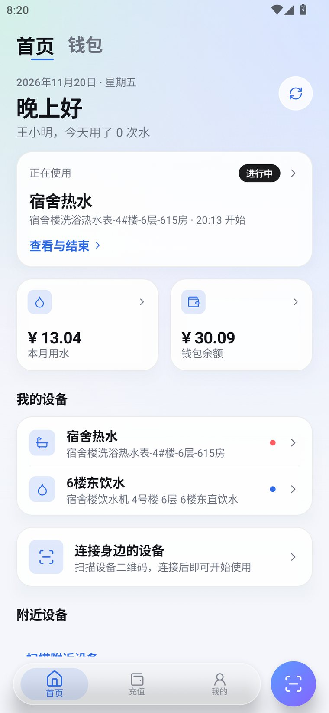
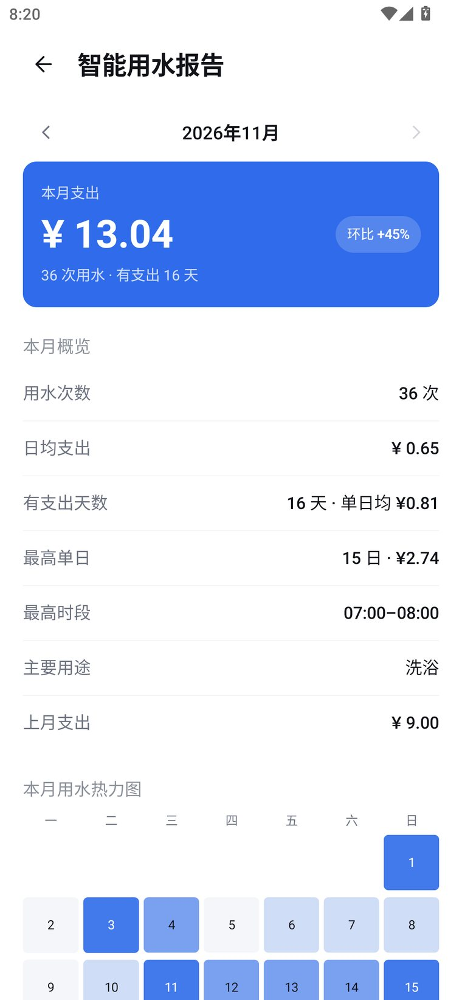

<div align="center">


# Hydros+

**趣智校园第三方 Android 客户端 · Kotlin + Jetpack Compose**

扫码、用水、账单，一条顺手的路径。

[](https://kotlinlang.org)
[](https://developer.android.com/jetpack/compose)
[](#)
[](LICENSE)

[功能](#-功能) · [构建](#-构建) · [更新日志](CHANGELOG.md) · [许可](#-许可)

</div>

> **声明**：本项目基于开源的 [Hydros](https://github.com/CQUT-OpenProject/Hydros) 二次开发，并非从零实现；界面与功能改动在 AI 辅助下以 **Vibe Coding** 方式完成，仅作个人学习实践与自用，不代表上游立场。上游项目与所有开源依赖的版权归其作者所有，详见[致谢](#-致谢)。

## 界面

<div align="center">

| 首页 | 智能用水报告 | 我的 |
|:---:|:---:|:---:|
|  |  |  |

<sub>截图使用演示数据，仅用于展示界面布局。</sub>

</div>

## 简介

Hydros+ 基于开源的 [Hydros](https://github.com/CQUT-OpenProject/Hydros) 二次开发，使用 Kotlin 与 Jetpack Compose 编写。

上游已经完成了协议、连接设备与账单这些核心能力；本项目在其基础上重做了界面，并补上几项日常更常用的功能：月度用水报告、用水限额提醒、使用码、绑定寝室与在线充值。

开发过程以 **Vibe Coding** 为主：由 AI 辅助完成界面重构、功能移植与文档编写，人工负责需求判断、验收与发布。

## ✨ 功能

**用水**
扫码连接设备、长按开始、实时计时、结束后自动刷新账单；支持相册选图、双指变焦与焦距显示。

**账单**
钱包余额、消费与充值记录、按月切换、账单详情；支持下拉刷新与失败重试。

**设备**
附近设备扫描、收藏常用设备、自定义备注、设备详情与状态查看。

**拓展**
智能用水报告（月度总览、按天热力图、月末预测、节水建议）、用水限额提醒、使用码、绑定寝室、充值（支付宝 / 聚合收银台 / 校园卡）。

**个性化**
深浅模式、主题色、强调色、字体、渐变背景与自定义壁纸、桌面图标。

## 🧱 技术栈

| 分类 | 选型 |
|---|---|
| 语言 / UI | Kotlin、Jetpack Compose、Material 3 |
| 架构 | 单 Activity + Navigation Compose，手写依赖装配 |
| 状态 | `StateFlow` + 单一 `HydrosUiState` + ViewModel |
| 网络 | Retrofit + OkHttp + kotlinx.serialization |
| 存储 | DataStore Preferences、应用私有文件 |
| 硬件 | CameraX + ML Kit（扫码）、蓝牙（附近设备） |
| 构建 | AGP 9.4、Gradle 9.6、JDK 21，minSdk 31 / targetSdk 35 |

## 🔨 构建

需要 JDK 21 与 Android SDK（compileSdk 37）。

```bash
./gradlew :app:assembleDebug     # 调试包
./gradlew :app:assembleRelease   # 发布包（需签名配置）
```

发布构建通过环境变量注入签名：

```bash
export ANDROID_KEYSTORE_PATH=/path/to/your.jks
export ANDROID_KEYSTORE_PASSWORD=******
export ANDROID_KEY_ALIAS=******
export ANDROID_KEY_PASSWORD=******
```

版本号只改 `gradle.properties` 中的 `hydrosVersion`（`X.Y.Z`），`versionCode` 会自动计算。

## 📄 说明

- 本项目为个人学习实践作品，**非官方客户端**，与趣智校园无任何关联。
- 所有接口均来自互联网公开信息，未对原应用进行破解或逆向；仓库不提供任何教程或服务端实现。
- 请于下载后 24 小时内删除，使用本软件产生的后果由使用者自行承担。

## 🙏 致谢

- [CQUT-OpenProject/Hydros](https://github.com/CQUT-OpenProject/Hydros)：本项目的上游，核心协议、数据层与页面骨架均来自这里，Apache-2.0
- **muguang**、**quzhi-campus-third-party**：同源开源项目，「使用码 / 绑定寝室 / 充值」三个功能移植自它们
- [Lucide](https://lucide.dev)：界面图标
- Jetpack Compose、Retrofit、OkHttp、kotlinx.serialization、CameraX、ML Kit 等开源库

再次感谢上游作者与所有开源贡献者。

## 📜 许可

[Apache-2.0](LICENSE) © 2026 UE-DND
